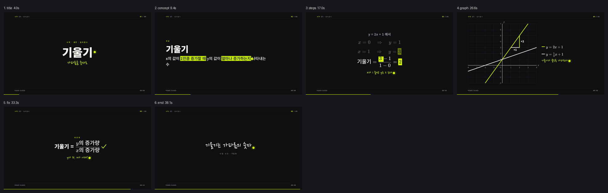
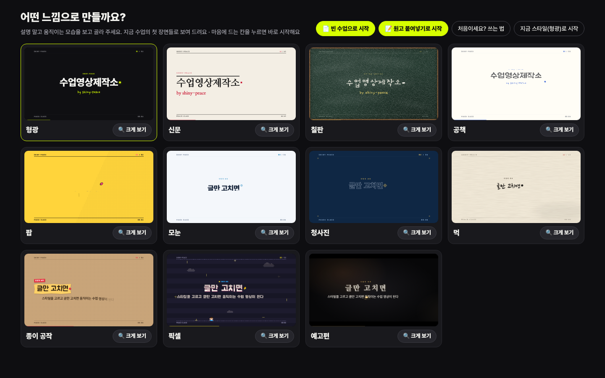

# 🎬 shiny-peace 수업영상제작소

선생님을 위한 수업 모션 그래픽 스튜디오 · **by shiny-peace** (Shiny Peace Studio)

**수업 원고를 30초~1분짜리 수업 모션 그래픽으로.** 형광 점 하나가 제목을 밝히고, 핵심 말에 형광펜을 칠하고, 그래프를 그리고, 마침표가 됩니다.
스타일을 눈으로 고르고, 글을 화면에서 고치고, 내 목소리와 사진을 넣어 **파일 하나**로 저장합니다.

> ## ▶ 지금 바로 열기 — 받지 않아도 돼요
> **[수업영상제작소 열기](https://shineonyou1274.github.io/peace-graphics/download/%EC%88%98%EC%97%85%EC%98%81%EC%83%81%EC%8A%A4%ED%8A%9C%EB%94%94%EC%98%A4.html)** · [완성 예시(광합성) 보기](https://shineonyou1274.github.io/peace-graphics/download/%EC%98%88%EC%8B%9C_%EA%B4%91%ED%95%A9%EC%84%B1_%EC%88%98%EC%97%85%EC%9A%A9.html)
> 크롬 · 엣지 · 웨일에서 누르면 바로 열려요. 내 컴퓨터에 두고 인터넷 없이 쓰려면 아래 안내대로 파일을 받으세요.

> ## 🔰 만드는 길은 두 가지예요
> **① 컴퓨터에서 스튜디오로 직접** → **[처음부터 따라 하기](docs/시작하기.md)** — 설치 없이 크롬 · 엣지 · 웨일만 있으면 됩니다. 20분이면 첫 수업 영상.
> **② Claude 에게 맡기기 (PC · 휴대폰 어디서든)** → **[Claude 에게 맡기기](docs/시작하기.md#-claude-에게-맡기기--pc--휴대폰-모두)** — 원고(또는 교과서 사진)와 **10초 목소리 샘플**만 주면 **내 목소리가 들어간 mp4** 가 나옵니다.

## 한눈에
설치 없이 브라우저로 열고, **움직이는 스타일을 보고 고른 뒤 글만 고치면** 수업 영상이 돼요.
- 스타일 11가지 · 장면 넘김 12가지를 직접 움직여 보고 골라요
- 수식 · 그래프 · 연표 · 사진 이름표 · 한글 조립 같은 교과용 장면 틀
- 목소리: **직접 녹음**(장면마다 🎙) · **내 목소리 AI**(10초 샘플로 무료 AI 사이트에서 하나씩) · **Claude 에게 맡기면** 샘플 하나로 대사 전부 · 자막 · mp4 까지 자동
- **수업용 파일** 또는 **mp4 영상**으로 바로 저장 (4단계 · 클로드 없이도 돼요)

### ❓ Claude 에게 맡길 때는 무엇을 주면 되나요?
**처음 한 번**: [peace-class.zip](download/peace-class.zip) 을 받아 Claude 에 스킬로 올려요 ([방법](docs/시작하기.md#스킬-올리기-처음-한-번)).
**그다음 새 대화에 이것만:**

| 줄 것 | 예시 | 꼭? |
|---|---|---|
| **주제 · 학년 · 화면** | "중1 과학 광합성, 16:9" | 필수 |
| **원고 또는 교과서 사진** | 수업 원고 · 교과서 · 학습지 사진 | 있으면 정확해요 |
| **10초 목소리 녹음** | 휴대폰 음성 메모 · PC 녹음기 — 아무 말이나 또박또박, 끝까지 말하고 1초 쉬기 | 내 목소리를 넣고 싶을 때 |
| **보여 줄 사진** | 실험 사진 · 직접 찍은 잎 사진 | 선택 |

> 예) *"중1 과학 광합성 수업 영상 만들어 줘. 16:9. 목소리는 이 녹음으로 해 줘."* + 녹음 파일 + 교과서 사진

Claude 가 **장면 표**를 먼저 보여 주고, *"좋아요"* 하면 **내 목소리가 들어간 mp4** 와 **고칠 수 있는 스튜디오 파일**을 보내 줘요. **대사는 선생님이 읽지 않아도 돼요.** 녹음과 만든 목소리는 그 대화 안에서만 쓰여요.

## 먼저 구경하기
| 과학 · 광합성 (16:9 · 35초) | 수학 · 일차함수의 기울기 (16:9 · 39초) | 사회 · 조선 전기의 흐름 (9:16 쇼츠 · 27초) |
|---|---|---|
|  |  |  |
| [영상 보기](samples/과학_광합성_16x9.mp4) · [수업용 파일](download/예시_광합성_수업용.html) | [영상 보기](samples/수학_일차함수의_기울기_16x9.mp4) | [영상 보기](samples/사회_조선_전기의_흐름_9x16.mp4) |

🎬 더 보기: [국어 · 자음 하나, 뜻 하나 (먹 스타일 · 한글 조립 · 36초)](samples/국어_자음하나_뜻하나_16x9.mp4) · [**점 하나의 모험** — 한 이야기를 장면마다 다른 스타일로 (11가지)](samples/점하나의모험_11가지스타일.mp4)

## 받을 것
| 파일 | 무엇 | 누구에게 |
|---|---|---|
| ⭐ **[수업영상스튜디오.html](download/수업영상스튜디오.html)** | 만드는 도구. 파일 하나 안에 다 들어 있어요 | 모든 선생님 |
| [peace-class.zip](download/peace-class.zip) | Claude 스킬. 원고나 교과서 사진을 주면 장면을 짜서 스튜디오 파일을 만들어 줍니다 | Claude 를 쓰는 선생님 |

| 하고 싶은 것 | 필요한 것 |
|---|---|
| 스튜디오로 만들기 · 수업용 파일 · 윈도우 화면 녹화로 mp4 | **무료 · 설치 없음** (크롬 · 엣지 · 웨일) |
| Claude 에게 원고 · 사진 주고 만들게 하기 | Claude 계정 (무료 요금제도 됨) + 스킬 올리기 |
| **Claude 가 내 목소리로 읽어 mp4 까지** | Claude 계정 + 스킬 올리기 + **10초 목소리 샘플**(PC 녹음기 · 스튜디오 샘플 녹음 · 휴대폰 음성 메모 무엇이든). 설치 없음 · **PC · 휴대폰 모두** (Claude 가 자기 작업 공간에 목소리 모델을 깔아 씀 · 1분 영상에 5~10분) |
| Claude 가 mp4 까지 구워 주기 | Claude 앱 대화의 작업 공간에서는 설치 없이 됨(확인). 내 컴퓨터에서 작업하는 Claude Code · Cowork 는 유료(Pro 이상) + 프로그램 한 번 설치 → [자세히](docs/시작하기.md#무엇이-필요한가요-요금제--설치) |

링크를 누르면 GitHub 화면에 코드나 *"표시할 수 없음"* 이 보입니다. 정상이에요. 오른쪽 위 **⬇ (Download raw file)** 버튼으로 받으세요.



## 스튜디오에서 하는 일
열면 스타일 11가지가 **움직이는 모습**으로 나와요. 마음에 드는 것을 누르고, 위쪽 **4단계**(① 스타일 · 효과 → ② 글 · 목소리 → ③ 흐름 보기 → ④ 저장)를 따라가면 돼요.

1. **스타일 11가지**: 형광 · 신문 · 칠판 · 공책 · 팝 · 모눈 · 청사진 · 먹 · 종이 공작 · 픽셀 · 예고편. **장면마다 다른 스타일**도 돼요. 색만이 아니라 **글꼴 · 강조 모양 · 점 · 장면 넘기는 움직임**이 다 다릅니다. 설명 대신 실제로 움직이는 모습을 보고 고릅니다. ([11가지를 한 이야기로 보기](samples/점하나의모험_11가지스타일.mp4))

   
2. **글 고치기**: 화면에 나올 글이 장면마다 칸으로 있습니다. 고치면 바로 미리보기에 나옵니다.
3. **장면 틀 13가지**: 제목 · 개념(형광펜) · 흔한 실수 → ✕ → 되감기 → 바로잡기 · 수식 풀이 · 함수 그래프(기울기 삼각형) · 막대그래프 · 연표 · 둘 비교 · 과정 · **사진(짚는 곳마다 이름표 · 사진이 없으면 스타일에 맞춘 그림 잎)** · **모아 보기(배운 것 정리 격자)** · **한글 조립(자모가 모여 글자 · 자모 하나로 뜻이 바뀜)** · 마무리(손글씨). 막대그래프는 대시보드처럼(커서 · 합계), 장면 넘김 12가지와 박자마다 쾅도 움직여 보고 고를 수 있어요
4. **내 목소리**: 장면마다 🎙 녹음하거나, **내 목소리 샘플 10초로 AI(Qwen3-TTS · 무료)가 대본을 읽게** 합니다. 말하는 동안 배경음이 작아지고, 대사는 **자막**으로 나옵니다. [자세히](docs/시작하기.md#6-2-내-목소리-샘플로-ai-가-읽게-하기)
5. **점검**: 글이 화면을 넘치거나 겹치면 알려 줍니다.
6. **수업용 파일 저장**: 파일 하나(`○○_수업용.html`). 수업 때 열고 → ← 로 장면을 넘기며 설명합니다. 다른 선생님께 그대로 보내면 됩니다.
7. **mp4 가 필요하면**: 윈도우 화면 녹화(Win + Alt + R), 또는 Claude 에게 부탁. [자세히](docs/시작하기.md#11-mp4-영상-파일이-필요할-때)

## Claude 와 함께 만들기
[peace-class.zip](download/peace-class.zip) 을 Claude 에 올리고([올리는 법](docs/시작하기.md#스킬-올리기-처음-한-번)) 원고를 주세요.
```
수업 영상 만들어줘. 중1 과학 광합성, 수업 도입 40초, 16:9.
원문 사실: 광합성은 식물이 빛에너지를 이용하여 물과 이산화 탄소로 양분을 만드는 과정 …
```
Claude 가 먼저 **필요한 것**을 알려 주고, **스타일(그림 보고 체크) · 목소리 · 사진**을 체크로 묻습니다. 교과서 · 학습지 사진을 올려도 됩니다. 그다음 장면 표를 보여 주고(확인) → 글이 채워진 **스튜디오 파일**을 줍니다 → 선생님이 스타일을 고르고 다듬어 저장합니다. 시나리오 파일을 다시 주면 이어서 손보거나 mp4 로 만들어 줍니다.

<details><summary>직접 돌릴 때 (개발자용 · Python 3)</summary>

```bash
python3 skills/peace-class/scripts/peace.py new    내수업 --from science-photosynthesis
python3 skills/peace-class/scripts/peace.py studio 내수업        # 스튜디오 파일
python3 skills/peace-class/scripts/peace.py share  내수업        # 수업용 파일 바로
python3 skills/peace-class/scripts/peace.py build  내수업 && python3 skills/peace-class/scripts/peace.py check 내수업 && python3 skills/peace-class/scripts/peace.py video 내수업   # mp4 — Node + Playwright + ffmpeg 필요
./scripts/build.sh   # 스킬 zip · 스튜디오 파일 다시 묶기
```
</details>

---

## 스킬 설치
### Claude 앱 (데스크톱 · 웹)
1. **[peace-class.zip 받기](download/peace-class.zip)** → 파일 화면 오른쪽 위 다운로드 버튼(⬇)을 누릅니다. 압축은 풀지 마세요.
2. Claude → **사용자 지정(Customize) → 스킬(Skills) → + → 스킬 올리기** 에서 파일을 올리고 스위치를 켭니다. ([자세한 순서](docs/시작하기.md#스킬-올리기-처음-한-번))

### Claude Code
```bash
git clone https://github.com/shineonyou1274/peace-graphics.git
mkdir -p ~/.claude/skills
cp -r peace-graphics/skills/peace-class ~/.claude/skills/
```

### 직접 묶기
```bash
./scripts/build.sh                # skills/ 안의 스킬을 dist/*.skill · download/*.zip 으로 · 빈 스튜디오도 새로
```

## 저장소 구조
```
download/                 받을 것 — 스튜디오 · 예시 수업용 파일 · 스킬 zip
docs/                     처음부터 따라 하기 · 그림
samples/                  견본 영상
skills/
└── peace-class/          수업 영상 스킬 — engine(재생기 · 스튜디오) · scripts(peace.py · render.mjs) · examples · references
scripts/build.sh          스킬 zip · 스튜디오 파일로 묶기
```

## 출처 · 크레딧
Shiny Peace Studio 가 직접 만든 영상 엔진과 취향 기록을 바탕으로 새로 만들었습니다. 함께 실은 글꼴 · 수식 라이브러리의 라이선스는 [NOTICE.md](NOTICE.md) 에 있습니다.

## 함께 만들기
- 틀린 내용 · 불편한 점 · "우리 과목은 이렇게 썼어요" 사례는 Issue 로 알려 주세요.

---
**만든 사람: shiny-peace** (Shiny Peace Studio) · 문의 · 고칠 점은 이 저장소의 Issues 에 남겨 주세요.
