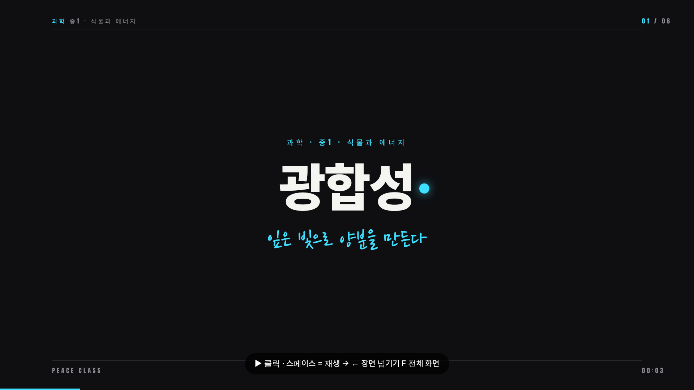
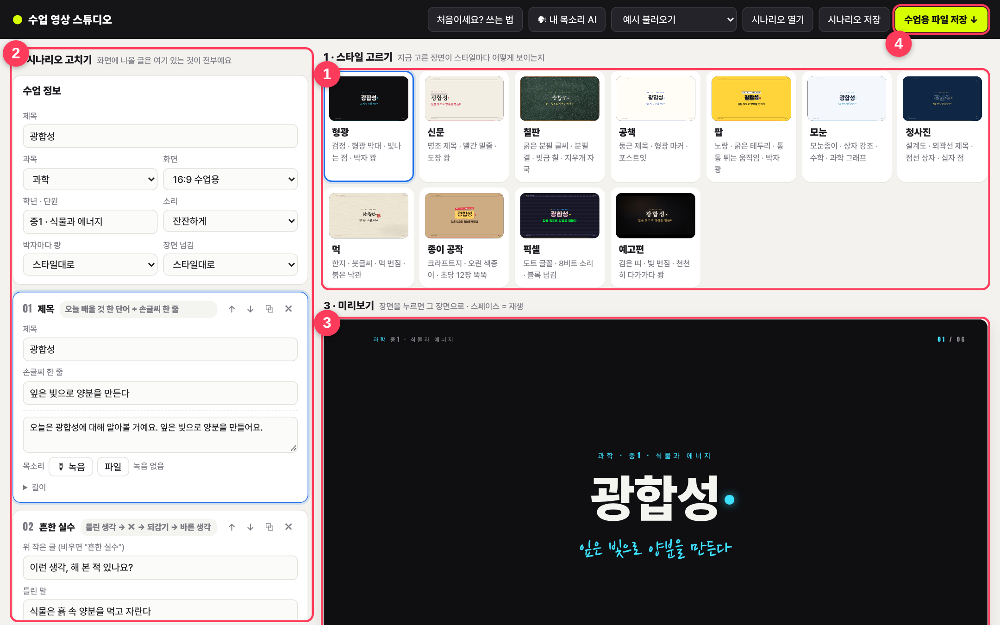

# 🎬 Peace Graphics — 선생님을 위한 수업 영상 스튜디오

**수업 원고를 30초~1분짜리 수업 모션 그래픽으로.** 형광 점 하나가 제목을 밝히고, 핵심 말에 형광펜을 칠하고, 그래프를 그리고, 마침표가 됩니다.
스타일을 눈으로 고르고, 글을 화면에서 고치고, 내 목소리와 사진을 넣어 **파일 하나**로 저장합니다.

> ## 🔰 처음이세요? → **[처음부터 따라 하기](docs/시작하기.md)**
> 설치 없이, 크롬 · 엣지 · 웨일만 있으면 됩니다. 그림을 보면서 위에서부터 따라 하면 20분 안에 첫 수업 영상이 나옵니다.

## 먼저 구경하기
| 과학 · 광합성 (16:9 · 35초) | 수학 · 일차함수의 기울기 (16:9 · 39초) | 사회 · 조선 전기의 흐름 (9:16 쇼츠 · 27초) |
|---|---|---|
|  |  |  |
| [영상 보기](samples/과학_광합성_16x9.mp4) · [수업용 파일](download/예시_광합성_수업용.html) | [영상 보기](samples/수학_일차함수의_기울기_16x9.mp4) | [영상 보기](samples/사회_조선_전기의_흐름_9x16.mp4) |

## 받을 것
| 파일 | 무엇 | 누구에게 |
|---|---|---|
| ⭐ **[수업영상스튜디오.html](download/수업영상스튜디오.html)** | 만드는 도구. 파일 하나 안에 다 들어 있어요 | 모든 선생님 |
| [peace-class.zip](download/peace-class.zip) | Claude 스킬. 원고나 교과서 사진을 주면 장면을 짜서 스튜디오 파일을 만들어 줍니다 | Claude 를 쓰는 선생님 |
| [motion-studio-academy.zip](download/motion-studio-academy.zip) | motion-studio 사용법을 배우는 학습 튜터 (아래 설명) | motion-studio 를 쓰는 선생님 |

| 하고 싶은 것 | 필요한 것 |
|---|---|
| 스튜디오로 만들기 · 수업용 파일 · 윈도우 화면 녹화로 mp4 | **무료 · 설치 없음** (크롬 · 엣지 · 웨일) |
| Claude 에게 원고 · 사진 주고 만들게 하기 | Claude 계정 (무료 요금제도 됨) + 스킬 올리기 |
| Claude 가 mp4 까지 구워 주기 | 환경에 따라 다름. 내 컴퓨터에서 작업하는 Claude Code · Cowork 는 유료(Pro 이상) + 프로그램 한 번 설치 → [자세히](docs/시작하기.md#무엇이-필요한가요-요금제--설치) |

링크를 누르면 GitHub 화면에 코드나 *"표시할 수 없음"* 이 보입니다. 정상이에요. 오른쪽 위 **⬇ (Download raw file)** 버튼으로 받으세요.



## 스튜디오에서 하는 일
1. **스타일 11가지**: 형광 · 신문 · 칠판 · 공책 · 팝 · 모눈 · 청사진 · 먹 · 종이 공작 · 픽셀 · 예고편. 색만이 아니라 **글꼴 · 강조 모양 · 점 · 장면 넘기는 움직임**이 다 다릅니다. 지금 장면이 11가지로 나란히 보입니다. ([움직임 비교 영상](samples/스타일11가지_움직임.mp4))

   
2. **글 고치기**: 화면에 나올 글이 장면마다 칸으로 있습니다. 고치면 바로 미리보기에 나옵니다.
3. **장면 틀 12가지**: 제목 · 개념(형광펜) · 흔한 실수 → ✕ → 되감기 → 바로잡기 · 수식 풀이 · 함수 그래프(기울기 삼각형) · 막대그래프 · 연표 · 둘 비교 · 과정 · **사진(짚는 곳마다 이름표)** · **한글 조립(자모가 모여 글자 · 자모 하나로 뜻이 바뀜)** · 마무리(손글씨). 막대그래프는 대시보드처럼(커서 · 합계), 장면 넘김은 끝없는 줌, 박자마다 쾅도 고를 수 있어요
4. **내 목소리**: 장면마다 🎙 녹음하거나, **내 목소리 샘플 10초로 AI(Qwen3-TTS · 무료)가 대본을 읽게** 합니다. 말하는 동안 배경음이 작아집니다. [자세히](docs/시작하기.md#6-2-내-목소리-샘플로-ai-가-읽게-하기)
5. **점검**: 글이 화면을 넘치거나 겹치면 알려 줍니다.
6. **수업용 파일 저장**: 파일 하나(`○○_수업용.html`). 수업 때 열고 → ← 로 장면을 넘기며 설명합니다. 다른 선생님께 그대로 보내면 됩니다.
7. **mp4 가 필요하면**: 윈도우 화면 녹화(Win + Alt + R), 또는 Claude 에게 부탁. [자세히](docs/시작하기.md#11-mp4-영상-파일이-필요할-때)

## Claude 와 함께 만들기
[peace-class.zip](download/peace-class.zip) 을 Claude 에 올리고([올리는 법](docs/시작하기.md#스킬-올리기-처음-한-번)) 원고를 주세요.
```
수업 영상 만들어줘. 중1 과학 광합성, 수업 도입 40초, 16:9.
원문 사실: 광합성은 식물이 빛에너지를 이용하여 물과 이산화 탄소로 양분을 만드는 과정 …
```
Claude 가 먼저 **필요한 것**을 알려 주고, **스타일(그림 보고 체크) · 목소리 · 사진**을 체크로 묻습니다. 교과서 · 학습지 사진을 올려도 됩니다. 그다음 장면 표를 보여 주고(확인) → 글이 채워진 **스튜디오 파일**을 줍니다 → 선생님이 스타일을 고르고 다듬어 저장합니다. 시나리오 파일을 다시 주면 이어서 손보거나 mp4 로 만들어 줍니다.

<details><summary>직접 돌릴 때 (개발자용 · Python 3)</summary>

```bash
python3 skills/peace-class/scripts/peace.py new    내수업 --from science-photosynthesis
python3 skills/peace-class/scripts/peace.py studio 내수업        # 스튜디오 파일
python3 skills/peace-class/scripts/peace.py share  내수업        # 수업용 파일 바로
python3 skills/peace-class/scripts/peace.py build  내수업 && python3 skills/peace-class/scripts/peace.py check 내수업 && python3 skills/peace-class/scripts/peace.py video 내수업   # mp4 — Node + Playwright + ffmpeg 필요
./scripts/build.sh   # 스킬 zip · 스튜디오 파일 다시 묶기
```
</details>

---

## motion-studio-academy — motion-studio 배우기

**수학 · 과학 개념 설명, 그래프, 국어 · 영어 · 사회 수업 영상을 Claude 로 직접 만들 수 있게 가르쳐 주는 학습 스킬 모음**

Claude 의 **motion-studio** 스킬은 글 · 문서 · 사진 · 영상을 받아 모션 그래픽 영상(mp4)을 만듭니다.
이 저장소의 **motion-studio-academy** 는 Claude 를 과외 선생님으로 바꿔, 처음 쓰는 선생님도
**30분 안에 첫 수업 영상을 시작**하도록 레슨 · 퀴즈 · 과목별 실습으로 차근차근 알려 줍니다.

> 이 스킬은 영상을 직접 만들지 않습니다. 쓰는 법을 가르치고, 준비가 되면 motion-studio 로 넘겨 줍니다.

---

## 👩‍🏫 선생님이라면 이렇게 쓰세요

```
선생님인데 수업 영상 만드는 법 배우고 싶어요
```
또는 과목을 바로 말해도 됩니다 — `수학 개념 설명 영상 배우기` · `과학 그래프 영상` · `영어 수업 영상`

### 과목별로 무엇을 할 수 있나 (예)
| 과목 | 이런 장면 |
|---|---|
| **수학** | 도형이 다른 도형으로 변신 · 좌표평면에 직선 · 곡선이 그려지며 등장 · 막대 · 원 · 꺾은선 그래프 · 100명 중 37명 아이콘 · 풀이 한 줄씩 |
| **과학** | 지구 공전 궤도 · 톱니바퀴 힘의 전달 · 진자 · 실험값 그래프 · 실험 영상 멈추고 짚기 · 물결 |
| **국어** | 자음 · 모음 · 받침이 날아와 글자로 조립 · 획 순서 손글씨 · 맞춤법 고쳐 치기 · 시 낭송 + 자막 |
| **영어** | 단어 타자 · 문장 성분 색 나누기 · 틀린 문장 → 되감기 → 바른 문장 · 듣기 자막 |
| **사회** | 연표 타임라인 · 지도 핀 · 인구 · 투표율 그래프 · 시대별 순위 바 차트 레이스 · 병풍 펼치기 |
| **학교 일** | 가정통신문 → 학부모 쇼츠 · 체험학습 사진 쇼츠 · 에듀테크 사용법 화면 녹화 |

✅ 바로 되는 것과 🟡 준비가 더 필요한 것(2층 수식 · 구조도 · 3D 등)을 레슨에서 솔직하게 구분해 알려 줍니다.

### 꼭 알아 둘 세 가지
1. **화면에 나오는 사실 · 숫자는 선생님 원고에서만 나옵니다.** 스킬이 지어내지 않으니, 원고를 정확히 써 주세요 (원고 틀 제공).
2. **그림 생성 · 목소리 합성은 하지 않습니다.** 그림은 프롬프트를 받아 선생님이 뽑고, 나레이션은 선생님 목소리로 녹음합니다.
3. **학생 얼굴 · 이름은 동의를, 교과서 그림 · 지문은 저작권을** 확인해 주세요.

---

## 무엇을 배우나

| # | 레슨 | 배우는 것 |
|---|---|---|
| 00 | 오리엔테이션 | 세 스킬 · 되는 것 · 안 되는 것 |
| 01 | 시작하기 | 부르는 법 · 시작 카드 |
| 02 | 영상 한 편의 흐름 | 사람이 하는 6가지 일 |
| 03 | 영상 종류별 길 | 내 자료는 어느 길로 |
| 04 | 준비물과 작업 폴더 | 무엇을 어디에 |
| 05 | 캔버스 | 화면 고치기 · "검수 끝" |
| 06 | 굽기 위치 | 클라우드 vs 내 컴퓨터 |
| 07 | 굽고 나서 고치기 | 피드백 뷰어 · 배경음 바꾸기 |
| 08 | 소리 · 나레이션 · 자막 | 녹음 · 받아쓰기 |
| 09 | 모션 메뉴판 | 움직임을 코드로 주문 |
| 10 | 기획 · 레시피 · 시리즈 · 3D | 도우미 스킬 · 주고받기 |
| 11 | 졸업 | 졸업 퀴즈 · 첫 영상 |
| **T1** | **선생님 · 수업 영상 기본** | 모양 고르기 · 원고 쓰는 법 · 저작권 · 학생 정보 |
| **T2** | **선생님 · 과목별 레시피** | 수학 · 과학 · 국어 · 영어 · 사회 · 학교 일 |

그 밖에 — 퀴즈 36문제 · 실습 미션 6개 + **과목별 선생님 미션 6개(붙여 넣을 예시 원고 포함)** · 수업 원고 틀 · 용어집 · 한 장 요약 · 막힐 때 표 · 버전표

## 설치

### Claude 앱 (데스크톱 · 웹)
1. **[motion-studio-academy.zip 받기](download/motion-studio-academy.zip)** → 파일 화면 오른쪽 위 다운로드 버튼(⬇)을 누릅니다. 압축은 풀지 마세요.
2. Claude → **사용자 지정(Customize) → 스킬(Skills) → + → 스킬 올리기** 에서 파일을 올리고 스위치를 켭니다. ([자세한 순서](docs/시작하기.md#스킬-올리기-처음-한-번))

### Claude Code
```bash
git clone https://github.com/shineonyou1274/peace-graphics.git
mkdir -p ~/.claude/skills
cp -r peace-graphics/skills/motion-studio-academy ~/.claude/skills/
```

### 직접 묶기
```bash
./scripts/build.sh                # skills/ 안의 스킬을 모두 dist/*.skill · download/*.zip 으로
```

## 쓰는 법
| 이렇게 말하면 | 이렇게 됩니다 |
|---|---|
| `motion-studio 배우기` | 무엇을 할지 고르기 (처음부터 · 선생님 코스 · 질문 · 퀴즈 · 실습) |
| `선생님인데 수업 영상 배우고 싶어요` | 선생님 코스 — 과목을 묻고 그 과목 중심으로 |
| `굽기가 뭐야?` | 짧게 답하고 근거 레슨 안내 |
| `motion-studio 퀴즈` | 5문제 · 채점 · 복습 레슨 안내 |
| `과학 실습 미션` | 예시 원고 → 내 수업 원고 채우기 → motion-studio 로 |

## 함께 필요한 것
- 실제 영상을 만들려면 **motion-studio** 가 설치돼 있어야 합니다 (배우기만 할 때는 없어도 됩니다).
- Claude 데스크톱 · 코워크처럼 Artifact(Design) 도구와 컴퓨터 폴더 연결이 되는 환경.
- 레슨은 motion-studio **0.33.19** 기준. 버전이 낮으면 일부 기능은 업데이트가 필요합니다 — `reference/버전표.md`.

## 저장소 구조
```
download/                 받을 것 — 스튜디오 · 예시 수업용 파일 · 스킬 zip
docs/                     처음부터 따라 하기 · 그림
samples/                  견본 영상
skills/
├── peace-class/          수업 영상 스킬 — engine(재생기 · 스튜디오) · scripts(peace.py · render.mjs) · examples · references
└── motion-studio-academy/
    ├── SKILL.md          튜터 규칙
    ├── lessons/          레슨 00~11 · 선생님 T1 · T2
    ├── practice/         퀴즈 · 정답 · 실습 미션 · 선생님 미션
    └── reference/        한 장 요약 · 용어집 · 막힐 때 · 버전표 · 수업 원고 틀
scripts/build.sh          스킬 zip · 스튜디오 파일로 묶기
```

## 출처 · 크레딧
레슨은 **motion-studio · motion-plan · motion-3d** 스킬과 그 AI용 안내 문서(`motion-studio.4ai.md`, 2026-11-23)를 바탕으로 학습용으로 새로 쓴 것입니다. 원작 스킬과 안내 문서는 **원작자** 님이 만들었습니다. → [NOTICE.md](NOTICE.md)

## 함께 만들기
- 틀린 내용 · 새 버전과 다른 점 · "우리 과목은 이렇게 썼어요" 사례는 Issue 로 알려 주세요.
- 레슨 하나 = 파일 하나. 새 과목 · 새 레슨은 `lessons/` 에 파일을 더하고 `SKILL.md` 표와 이 README 에 한 줄 보태 주세요.
