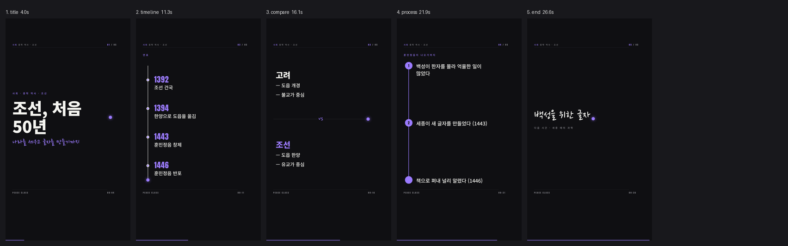

# 🎬 Peace Graphics — 선생님을 위한 수업 모션 그래픽

이 저장소에는 Claude 스킬이 두 개 있습니다.

| 스킬 | 하는 일 |
|---|---|
| **[peace-class](skills/peace-class/)** ⭐ | **수업 원고 → 수업 모션 그래픽**. 선생님이 스타일 6가지를 눈으로 고르고 시나리오를 화면에서 고치는 **수업 영상 스튜디오(파일 하나)**. 형광 점 하나가 제목을 밝히고, 형광펜이 되고, 그래프를 그리고, 연표의 시간이 되고, 마침표가 됩니다. 수식은 교과서처럼(KaTeX), 함수 그래프는 식을 계산해 정확히, 소리는 브라우저 안에서 새로 작곡 |
| **[motion-studio-academy](skills/motion-studio-academy/)** | motion-studio 사용법을 배우는 학습 튜터 (레슨 · 퀴즈 · 과목별 실습) |

### 견본 (peace-class 로 만든 영상)
| 수학 · 일차함수의 기울기 (16:9 · 39초) | 사회 · 조선 전기의 흐름 (9:16 쇼츠 · 27초) |
|---|---|
|  |  |
| [영상 보기](samples/수학_일차함수의_기울기_16x9.mp4) | [영상 보기](samples/사회_조선_전기의_흐름_9x16.mp4) |

### peace-class 장면 틀 10가지
제목 · 개념(형광펜) · 수식 전개(바뀐 곳 형광) · 함수 그래프(기울기 삼각형 · 점 찍기) · 막대그래프 · 연표 · 둘 비교 · **흔한 실수 → ✕ → 되감기 → 바로잡기** · 과정 · 마무리(손글씨)

### ⭐ 선생님은 이 파일 하나면 됩니다 — [수업 영상 스튜디오 받기](download/수업영상스튜디오.html) (링크를 열고 오른쪽 위 ⬇ 버튼)
내려받아 크롬 · 엣지 · 웨일로 열면 (인터넷 · 설치 · 로그인 없음):

1. **스타일 고르기** — 지금 장면이 6가지 스타일(형광 · 종이 · 칠판 · 공책 · 모눈 · 청사진)로 나란히 보입니다. 눌러서 고르세요.
2. **시나리오 고치기** — 화면에 나올 글이 장면마다 칸으로 있습니다. 고치면 바로 미리보기에 나옵니다. 장면 더하기 · 지우기 · 순서 바꾸기.
3. **목소리** — 장면마다 🎙 버튼으로 바로 녹음하거나 파일을 넣습니다.
4. **미리보기** — 소리와 함께 재생, 글이 넘치거나 겹치면 알려 줍니다.
5. **수업용 파일 저장** — 파일 하나(`<제목>_수업용.html`)로 저장. 수업 때 열고, 다른 선생님께 그대로 보내면 됩니다.

수업용 파일 조작: 클릭 · 스페이스 = 재생/멈춤 · → ← = 장면 넘기기 · F = 전체 화면 · R = 처음부터

### Claude 와 함께 만들기 (peace-class 스킬)
Claude 에 `peace-class.skill` 을 올리고 수업 원고를 주세요.
```
수업 영상 만들어줘. 중1 과학 광합성, 수업 도입 40초, 16:9.
원문 사실: 광합성은 식물이 빛에너지를 이용하여 물과 이산화 탄소로 양분을 만드는 과정 …
```
Claude 가 장면 표를 보여 주고(⏸ 확인) → 그 시나리오가 담긴 **스튜디오 파일**을 드립니다 → 선생님이 스타일을 고르고 글을 다듬어 **수업용 파일**로 저장합니다. 시나리오(.json)를 다시 Claude 에게 보내면 이어서 손봅니다.

직접 돌릴 때(Python 3 만 있으면 됨):
```bash
python3 skills/peace-class/scripts/peace.py new    내수업 --from science-photosynthesis
python3 skills/peace-class/scripts/peace.py studio 내수업        # 스튜디오 파일
python3 skills/peace-class/scripts/peace.py share  내수업        # 수업용 파일 바로
python3 skills/peace-class/scripts/peace.py build  내수업 && python3 skills/peace-class/scripts/peace.py check 내수업 && python3 skills/peace-class/scripts/peace.py video 내수업   # (선택) mp4 — Node + Playwright + ffmpeg 필요
```

---

## motion-studio-academy — motion-studio 배우기

**수학 · 과학 개념 설명, 그래프, 국어 · 영어 · 사회 수업 영상을 Claude 로 직접 만들 수 있게 가르쳐 주는 학습 스킬 모음**

Claude 의 **motion-studio** 스킬은 글 · 문서 · 사진 · 영상을 받아 모션 그래픽 영상(mp4)을 만듭니다.
이 저장소의 **motion-studio-academy** 는 Claude 를 과외 선생님으로 바꿔, 처음 쓰는 선생님도
**30분 안에 첫 수업 영상을 시작**하도록 레슨 · 퀴즈 · 과목별 실습으로 차근차근 알려 줍니다.

> 이 스킬은 영상을 직접 만들지 않습니다. 쓰는 법을 가르치고, 준비가 되면 motion-studio 로 넘겨 줍니다.

---

## 👩‍🏫 선생님이라면 이렇게 쓰세요

```
선생님인데 수업 영상 만드는 법 배우고 싶어요
```
또는 과목을 바로 말해도 됩니다 — `수학 개념 설명 영상 배우기` · `과학 그래프 영상` · `영어 수업 영상`

### 과목별로 무엇을 할 수 있나 (예)
| 과목 | 이런 장면 |
|---|---|
| **수학** | 도형이 다른 도형으로 변신 · 좌표평면에 직선 · 곡선이 그려지며 등장 · 막대 · 원 · 꺾은선 그래프 · 100명 중 37명 아이콘 · 풀이 한 줄씩 |
| **과학** | 지구 공전 궤도 · 톱니바퀴 힘의 전달 · 진자 · 실험값 그래프 · 실험 영상 멈추고 짚기 · 물결 |
| **국어** | 자음 · 모음 · 받침이 날아와 글자로 조립 · 획 순서 손글씨 · 맞춤법 고쳐 치기 · 시 낭송 + 자막 |
| **영어** | 단어 타자 · 문장 성분 색 나누기 · 틀린 문장 → 되감기 → 바른 문장 · 듣기 자막 |
| **사회** | 연표 타임라인 · 지도 핀 · 인구 · 투표율 그래프 · 시대별 순위 바 차트 레이스 · 병풍 펼치기 |
| **학교 일** | 가정통신문 → 학부모 쇼츠 · 체험학습 사진 쇼츠 · 에듀테크 사용법 화면 녹화 |

✅ 바로 되는 것과 🟡 준비가 더 필요한 것(2층 수식 · 구조도 · 3D 등)을 레슨에서 솔직하게 구분해 알려 줍니다.

### 꼭 알아 둘 세 가지
1. **화면에 나오는 사실 · 숫자는 선생님 원고에서만 나옵니다.** 스킬이 지어내지 않으니, 원고를 정확히 써 주세요 (원고 틀 제공).
2. **그림 생성 · 목소리 합성은 하지 않습니다.** 그림은 프롬프트를 받아 선생님이 뽑고, 나레이션은 선생님 목소리로 녹음합니다.
3. **학생 얼굴 · 이름은 동의를, 교과서 그림 · 지문은 저작권을** 확인해 주세요.

---

## 무엇을 배우나

| # | 레슨 | 배우는 것 |
|---|---|---|
| 00 | 오리엔테이션 | 세 스킬 · 되는 것 · 안 되는 것 |
| 01 | 시작하기 | 부르는 법 · 시작 카드 |
| 02 | 영상 한 편의 흐름 | 사람이 하는 6가지 일 |
| 03 | 영상 종류별 길 | 내 자료는 어느 길로 |
| 04 | 준비물과 작업 폴더 | 무엇을 어디에 |
| 05 | 캔버스 | 화면 고치기 · "검수 끝" |
| 06 | 굽기 위치 | 클라우드 vs 내 컴퓨터 |
| 07 | 굽고 나서 고치기 | 피드백 뷰어 · 배경음 바꾸기 |
| 08 | 소리 · 나레이션 · 자막 | 녹음 · 받아쓰기 |
| 09 | 모션 메뉴판 | 움직임을 코드로 주문 |
| 10 | 기획 · 레시피 · 시리즈 · 3D | 도우미 스킬 · 주고받기 |
| 11 | 졸업 | 졸업 퀴즈 · 첫 영상 |
| **T1** | **선생님 · 수업 영상 기본** | 모양 고르기 · 원고 쓰는 법 · 저작권 · 학생 정보 |
| **T2** | **선생님 · 과목별 레시피** | 수학 · 과학 · 국어 · 영어 · 사회 · 학교 일 |

그 밖에 — 퀴즈 36문제 · 실습 미션 6개 + **과목별 선생님 미션 6개(붙여 넣을 예시 원고 포함)** · 수업 원고 틀 · 용어집 · 한 장 요약 · 막힐 때 표 · 버전표

## 설치

### Claude 앱 (데스크톱 · 웹)
1. **[motion-studio-academy.skill 받기](download/motion-studio-academy.skill)** → 파일 화면 오른쪽 위 다운로드 버튼(⬇)을 누릅니다.
2. Claude → **설정 → 기능 → 스킬** 에서 파일을 올립니다.

### Claude Code
```bash
git clone https://github.com/shineonyou1274/peace-graphics.git
mkdir -p ~/.claude/skills
cp -r peace-graphics/skills/motion-studio-academy ~/.claude/skills/
```

### 직접 묶기
```bash
./scripts/build.sh                # skills/ 안의 스킬을 모두 dist/*.skill 로
```

## 쓰는 법
| 이렇게 말하면 | 이렇게 됩니다 |
|---|---|
| `motion-studio 배우기` | 무엇을 할지 고르기 (처음부터 · 선생님 코스 · 질문 · 퀴즈 · 실습) |
| `선생님인데 수업 영상 배우고 싶어요` | 선생님 코스 — 과목을 묻고 그 과목 중심으로 |
| `굽기가 뭐야?` | 짧게 답하고 근거 레슨 안내 |
| `motion-studio 퀴즈` | 5문제 · 채점 · 복습 레슨 안내 |
| `과학 실습 미션` | 예시 원고 → 내 수업 원고 채우기 → motion-studio 로 |

## 함께 필요한 것
- 실제 영상을 만들려면 **motion-studio** 가 설치돼 있어야 합니다 (배우기만 할 때는 없어도 됩니다).
- Claude 데스크톱 · 코워크처럼 Artifact(Design) 도구와 컴퓨터 폴더 연결이 되는 환경.
- 레슨은 motion-studio **0.33.19** 기준. 버전이 낮으면 일부 기능은 업데이트가 필요합니다 — `reference/버전표.md`.

## 저장소 구조
```
skills/
└── motion-studio-academy/
    ├── SKILL.md          튜터 규칙
    ├── lessons/          레슨 00~11 · 선생님 T1 · T2
    ├── practice/         퀴즈 · 정답 · 실습 미션 · 선생님 미션
    └── reference/        한 장 요약 · 용어집 · 막힐 때 · 버전표 · 수업 원고 틀
scripts/build.sh          .skill 파일로 묶기
```

## 출처 · 크레딧
레슨은 **motion-studio · motion-plan · motion-3d** 스킬과 그 AI용 안내 문서(`motion-studio.4ai.md`, 2026-11-23)를 바탕으로 학습용으로 새로 쓴 것입니다. 원작 스킬과 안내 문서는 **원작자** 님이 만들었습니다. → [NOTICE.md](NOTICE.md)

## 함께 만들기
- 틀린 내용 · 새 버전과 다른 점 · "우리 과목은 이렇게 썼어요" 사례는 Issue 로 알려 주세요.
- 레슨 하나 = 파일 하나. 새 과목 · 새 레슨은 `lessons/` 에 파일을 더하고 `SKILL.md` 표와 이 README 에 한 줄 보태 주세요.
