# 🔰 처음부터 따라 하기 — 수업 영상 스튜디오

이 안내 하나만 위에서부터 따라 하면 **첫 수업 영상**이 만들어집니다. 처음 해도 20분 안에 끝나요.

> **만드는 길은 두 가지예요.**
> - **스튜디오로 직접** (이 안내의 0~11번) — PC 와 크롬 · 엣지 · 웨일만 있으면 돼요. 인터넷 · 로그인 · 설치 · 결제 모두 필요 없어요. 화면이 넓어야 해서 PC 를 권해요.
> - **Claude 에게 맡기기** ([💬 Claude 에게 맡기기](#-claude-에게-맡기기--pc--휴대폰-모두) · [12번](#12-claude-와-함께-만들기-더-빠르게)) — 원고와 목소리 샘플만 주면 Claude 가 대사 · 목소리 · mp4 까지 만들어 줘요. **PC · 휴대폰 어디서든** 돼요.

## 무엇이 필요한가요? (요금제 · 설치)
| 만들 것 | 필요한 것 | 요금 |
|---|---|---|
| **스튜디오로 직접 만들기** (이 안내) | 컴퓨터 + 크롬 · 엣지 · 웨일 | **무료 · 설치 없음** · Claude 계정도 필요 없음 |
| **수업용 파일** (수업 때 트는 파일) | 위와 같음 | 무료 |
| **mp4 — 윈도우에서 직접 녹화** | 윈도우 기본 기능(Win + Alt + R) | 무료 |
| **Claude 가 내 목소리로 읽어 mp4 까지** ([💬](#-claude-에게-맡기기--pc--휴대폰-모두)) | Claude 계정 + 스킬 + 10초 목소리 샘플(PC · 휴대폰 무엇으로 녹음해도) | 설치 없음 · PC · 휴대폰 모두 |
| **Claude 에게 원고 · 사진 주고 만들게 하기** | Claude 계정 + peace-class 스킬 올리기 ([12번](#12-claude-와-함께-만들기-더-빠르게)) | 무료 요금제도 됨 |
| **mp4 — Claude 가 구워 주기** | 영상 굽는 프로그램(Node.js · Playwright · ffmpeg)이 있는 환경 | Claude 앱 대화의 작업 공간에는 이미 있어 설치 없이 돼요(확인). 선생님 컴퓨터에서 작업하는 **Claude Code · Cowork 는 유료(Pro 이상)** 이고, 프로그램을 한 번 깔아야 해요. Claude 가 `doctor` 점검으로 무엇을 깔지 알려 줍니다 |

> 요금제와 메뉴 이름은 바뀔 수 있어요. 정확한 요금은 claude.com/pricing 에서 확인하세요.

| 순서 | 할 일 | 걸리는 시간 |
|---|---|---|
| [0](#0-먼저-완성본-구경하기) | 완성본 구경하기 | 1분 |
| [1](#1-스튜디오-받기) | 스튜디오 받기 | 1분 |
| [2](#2-스튜디오-열기) | 스튜디오 열기 | 1분 |
| [3](#3-스타일-고르기) | 스타일 고르기 | 1분 |
| [4](#4-글-고치기) | 글 고치기 | 5~10분 |
| [5](#5-장면-더하기--빼기--순서-바꾸기) | 장면 더하기 · 빼기 · 순서 바꾸기 | 2분 |
| [6](#6-내-목소리-넣기-하고-싶을-때만) | 내 목소리 넣기 (하고 싶을 때만) | 5분 |
| [6-2](#6-2-내-목소리-샘플로-ai-가-읽게-하기) | 내 목소리 샘플로 AI 가 읽게 하기 (선택) | 10분 |
| [7](#7-사진-넣기-하고-싶을-때만) | 사진 넣기 (하고 싶을 때만) | 3분 |
| [8](#8-미리보기와-점검) | 미리보기와 점검 | 1분 |
| [9](#9-저장하기) | 저장하기 | 1분 |
| [10](#10-수업-시간에-틀기) | 수업 시간에 틀기 | — |
| [11](#11-mp4-영상-파일이-필요할-때) | mp4 영상 파일이 필요할 때 | 선택 |
| [12](#12-claude-와-함께-만들기-더-빠르게) | Claude 와 함께 만들기 | 선택 |
| [💬](#-claude-에게-맡기기--pc--휴대폰-모두) | Claude 에게 맡기기 — 내 목소리 · mp4 까지 (PC · 휴대폰) | 10분 |
| [🆘](#-이럴-땐) | 이럴 땐 | — |

---

## 0. 먼저 완성본 구경하기
무엇을 만들게 되는지 먼저 보세요. 중1 과학 「광합성」 수업 도입 영상(35초)입니다.

- 🎬 **[영상으로 보기 (mp4)](../samples/과학_광합성_16x9.mp4)**: GitHub 화면에서 바로 재생됩니다.
- 🖥 **[수업용 파일 받기](../download/예시_광합성_수업용.html)**: 우리가 마지막에 저장할 파일이 바로 이것입니다. 받는 법은 1번과 같아요.

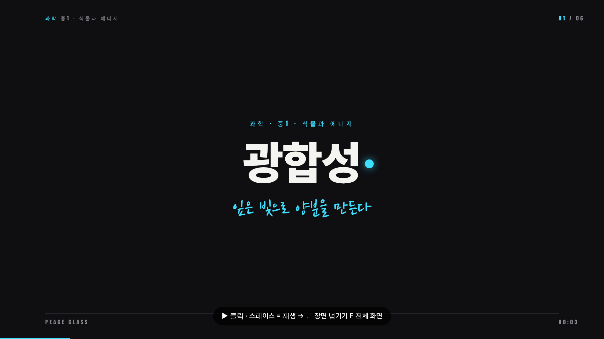

---

## 1. 스튜디오 받기
1. 이 링크를 누르세요 → **[수업영상스튜디오.html](../download/수업영상스튜디오.html)**
2. 화면에 *"표시할 수 없음"*, *"View raw"*, 또는 알 수 없는 코드가 보입니다. **정상이에요.** GitHub 는 이 파일을 보여 주지 못할 뿐, 파일에는 문제가 없습니다.
3. 오른쪽 위의 **⬇ (Download raw file)** 버튼을 누르세요. `수업영상스튜디오.html` 이 **다운로드 폴더**에 저장됩니다.

> 💡 저장소를 통째로 받고 싶다면: 저장소 첫 화면의 초록 **`<> Code`** 버튼 → **Download ZIP** → 압축 풀기 → `download` 폴더 안에 있습니다.

---

## 2. 스튜디오 열기
1. 다운로드 폴더에서 `수업영상스튜디오.html` 을 **더블클릭**하세요.
   - 크롬 · 엣지 · 웨일이 아닌 다른 프로그램으로 열리면: 파일에서 오른쪽 클릭 → **연결 프로그램** → 크롬(또는 엣지 · 웨일).
   - 또는 크롬 창을 하나 열고 파일을 그 위로 끌어다 놓아도 됩니다.
2. 처음 열면 *「처음이세요? 3분 안내」* 가 뜹니다. 읽고 **닫기**를 누르세요. 나중에 위쪽 **처음이세요? 쓰는 법** 버튼으로 다시 볼 수 있어요.

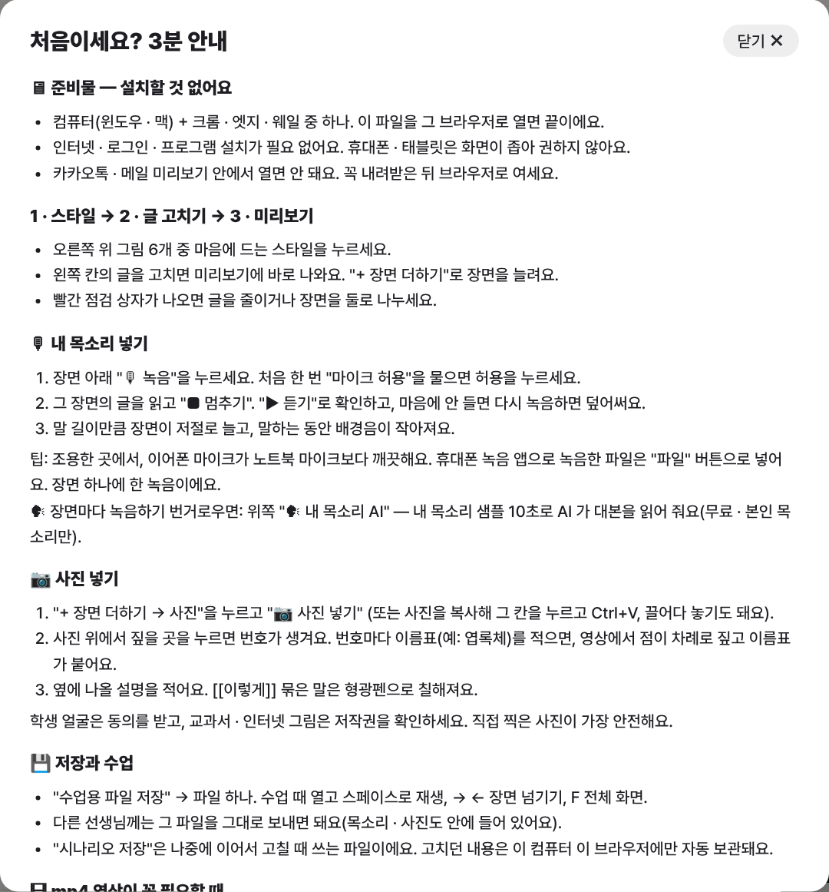

### 화면 한눈에 보기
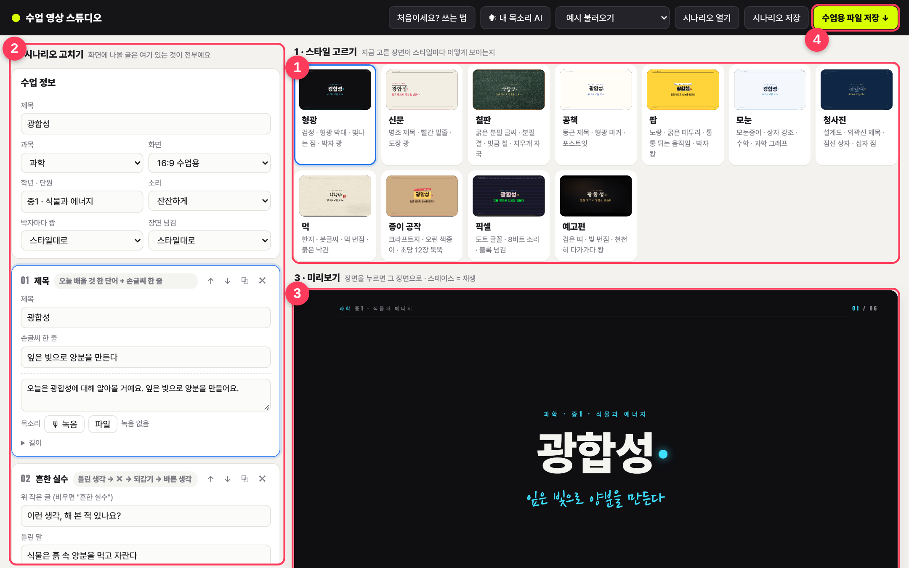

| 번호 | 이름 | 하는 일 |
|---|---|---|
| ① | 스타일 고르기 | 지금 장면이 11가지 스타일로 나란히 보입니다 |
| ② | 시나리오 고치기 | 화면에 나올 글이 장면마다 칸으로 있습니다. **영상의 글은 여기 있는 것이 전부**예요 |
| ③ | 미리보기 | 고친 것이 바로 보입니다. 스페이스 = 재생 |
| ④ | 수업용 파일 저장 | 다 만들면 누릅니다 |

처음에는 **광합성 예시**가 들어 있습니다. 이것을 고쳐 내 수업으로 바꾸면 됩니다. 다른 예시(수학 기울기 · 조선 연표 · 통계 막대그래프)는 위쪽 **예시 불러오기**에 있어요.

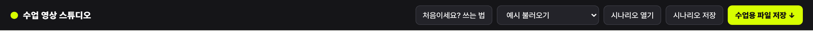

---

## 3. 스타일 고르기
오른쪽 위 그림 중 마음에 드는 것을 **누르기만** 하면 됩니다. 언제든 바꿀 수 있어요.

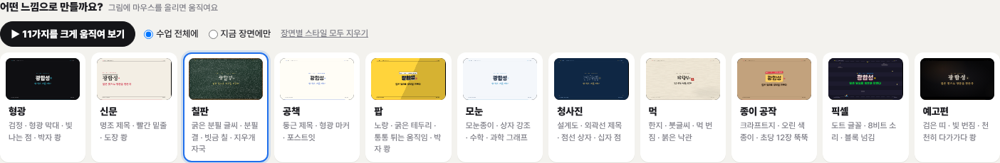

| 스타일 | 생김새 · 움직임 | 어울리는 곳 |
|---|---|---|
| **형광** | 검정 바탕 · 형광 막대 · 빛나는 점 | 어두운 교실 · 집중이 필요한 도입 |
| **신문** | 명조 제목 · 빨간 밑줄 · 왼쪽 정렬 · 지면 넘기기 | 사회 · 역사 · 국어 비문학 · 진지한 주제 |
| **칠판** | 굵은 분필 글씨 · 분필 결(구멍 · 떨림) · 빗금 칠 강조 · 나무 틀 · 지우개 자국 남기며 넘김 | 판서 느낌 · 수학 풀이 · 초등 |
| **공책** | 둥근 제목 · 노랑 형광 마커 · 포스트잇 비교 | 국어 · 영어 · 정리 노트 |
| **팝** | 노랑 · 굵은 검정 테두리 · 망점 · 통통 튀는 움직임 | 초등 · 동기 유발 · 쇼츠 |
| **모눈** | 모눈종이 · 상자 강조 | 수학 · 과학 그래프 |
| **청사진** | 외곽선 제목 · 점선 상자 · 십자 점 · 선 긋듯 넘김 | 기술 · 과학 원리 · 구조 |
| **먹** | 한지 · 붓글씨 · 먹 번짐 · 주홍 붓 밑줄 · 제목에 붉은 낙관 · 번지듯 넘김 | 국어 고전 시가 · 역사 · 한문 |
| **종이 공작** | 크라프트지 · 오려 붙인 색종이 제목 · 그림자 · 초당 12장 뚝뚝 | 초등 · 동화 · 도덕 |
| **픽셀** | 도트 글꼴 · 주사선 · 8비트 소리 · 블록으로 넘김 · 박자 쾅 | 정보 · 퀴즈 · 초등 |
| **예고편** | 검은 화면 · 위아래 띠 · 빛 번짐 · 천천히 다가가다 장면마다 낮게 쾅 | 단원 도입 훅 · 역사 사건 |

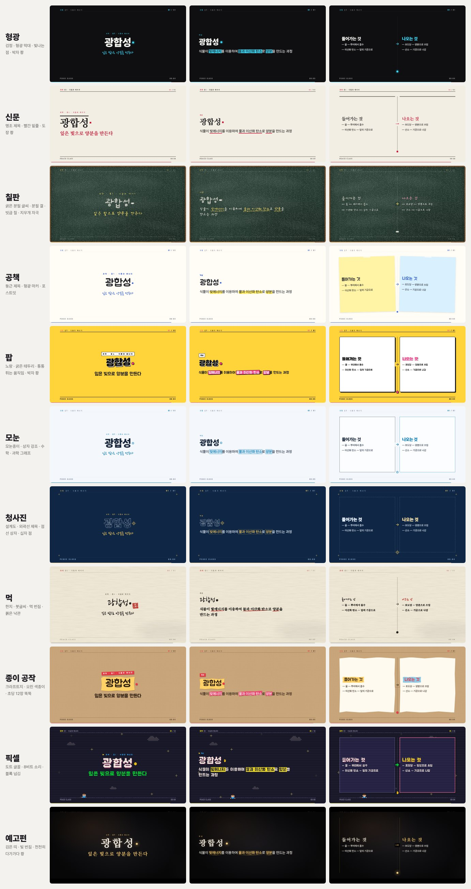

🎬 **[점 하나의 모험 보기](../samples/점하나의모험_11가지스타일.mp4)** — 점 하나가 열한 개의 세계를 건너는 이야기. 장면마다 다른 스타일 · 다른 대사로 움직임과 소리를 비교해 보세요. ([시나리오](../samples/점하나의모험_시나리오.json))

### 장면마다 다른 스타일
스타일 그림 위의 **지금 장면에만** 을 고르고 스타일을 누르면 그 장면만 바뀌어요. 장면 카드 맨 위의 **이 장면 스타일** 칸으로 골라도 돼요. 다시 하나로 맞추려면 **장면별 스타일 모두 지우기**. (예: 도입은 예고편 → 개념은 칠판 → 마무리는 형광)


> 💡 교실 프로젝터가 흐리면 **신문 · 공책 · 팝 · 모눈 · 먹 · 종이 공작** 처럼 밝은 스타일이 더 잘 보입니다.

**수업 정보**에서 두 가지를 더 고를 수 있어요.
- **박자마다 쾅**: 배경음 박자에 맞춰 화면이 살짝 튀어요. *스타일대로*(형광 · 팝 · 픽셀 · 예고편은 켜짐) · 켜기 · 끄기
- **장면 넘김**: *끝없는 줌* 을 고르면 점이 있는 곳으로 빨려 들어가고, 다음 장면이 그 점에서 열려요.

---

## 4. 글 고치기
1. 왼쪽 위 **수업 정보**에서 제목 · 과목 · 학년 · 단원 · 화면(16:9 수업용 / 9:16 쇼츠) · 소리 분위기를 정하세요.
2. 아래 장면 카드를 하나씩 내려가며 칸의 글을 고치세요. **고치는 즉시 오른쪽 미리보기에 나옵니다.**
3. 카드를 누르면 미리보기가 그 장면으로 갑니다.

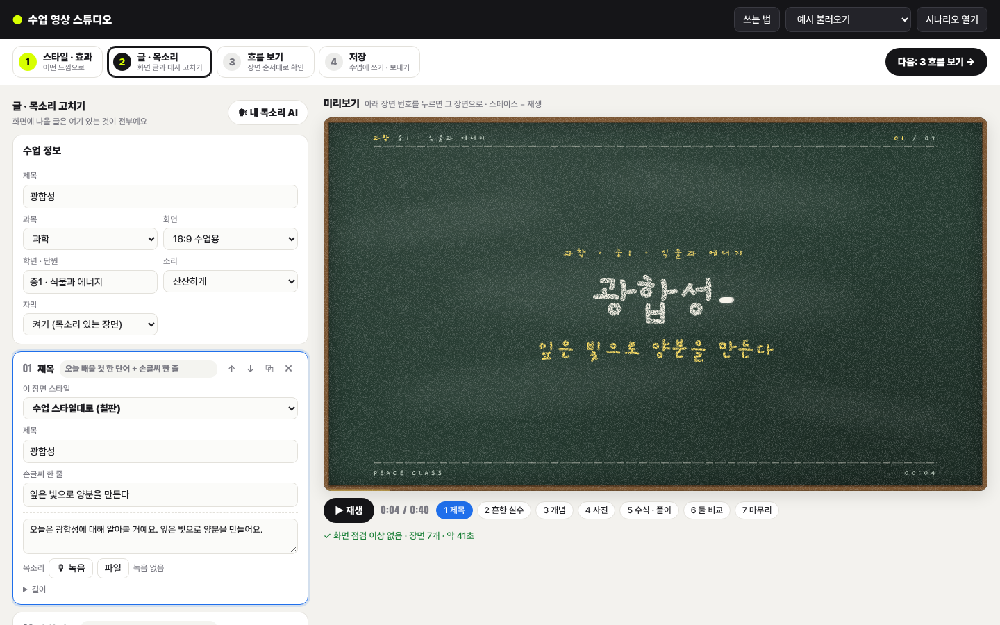

### 글에 쓰는 표시 두 가지
| 이렇게 쓰면 | 화면에서는 |
|---|---|
| `[[양분]]` | **양분** 에 형광펜이 칠해집니다 |
| 수식 칸에 `\hl{x = 2}` | 수식 안에서 그 부분이 형광으로 |

수식 칸은 LaTeX 를 씁니다(예: `\dfrac{1}{2}`, `x^2`, `\sqrt{x}`). 잘 모르겠으면 수식 칸 아래 **수식으로 보기**를 끄고 그냥 글로 써도 됩니다.

> ⚠️ **사실 · 숫자 · 연도는 꼭 교과서와 대조하세요.** 예시 글은 초안입니다.

---

## 5. 장면 더하기 · 빼기 · 순서 바꾸기
- **더하기**: 장면 목록 맨 아래 **+ 장면 더하기** 에서 원하는 틀을 누르세요.
- **카드 오른쪽 위 버튼**: `↑` `↓` 순서 바꾸기 · `⧉` 복제 · `✕` 지우기

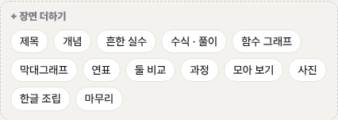

| 장면 틀 | 이럴 때 |
|---|---|
| 제목 | 첫 화면. 오늘 배울 것 한 단어 + 손글씨 한 줄 |
| 개념 | 용어와 정의. 핵심 말에 형광펜 |
| 흔한 실수 | 틀린 생각 → ✕ → 되감기 → 바른 생각 |
| 수식 · 풀이 | 한 줄씩 올라오고 바뀐 곳은 형광 |
| 함수 그래프 | 식을 적으면 정확히 그려 줌. 점 · 기울기 삼각형 |
| 막대그래프 | 통계 자료 (출처를 꼭 적기). *대시보드* 를 켜면 커서가 가장 큰 막대를 누르고 합계 카드가 숫자를 셈 |
| 연표 | 때와 일이 선 위로 차례로 |
| 둘 비교 | 왼쪽 · 오른쪽이 엇갈려 들어옴 |
| 과정 | 단계가 차례로 채워짐 |
| 사진 | 사진을 넣고 짚는 곳마다 이름표 |
| 한글 조립 | 국어 낱말 · 음운. 자모가 날아와 글자가 되고, 자모 하나가 바뀌면 뜻이 바뀜 (예: 불 → 풀 → 뿔) |
| 마무리 | 전할 것 한 문장. 점이 마침표가 됨 |

> 💡 **좋은 수업 영상 공식**: 제목 → 흔한 실수(또는 질문) → 설명 장면 2~4개 → 마무리. 30~60초면 충분합니다. **같은 틀을 연달아 쓰지 않으면** 지루하지 않아요.

---

## 6. 내 목소리 넣기 (하고 싶을 때만)
장면 카드 아래쪽에 **목소리** 줄이 있습니다.

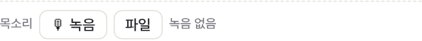

1. **🎙 녹음** 을 누르세요.
2. 처음 한 번 주소창 아래에 *"마이크를 사용하도록 허용할까요?"* 가 뜹니다 → **허용**.
3. 그 장면의 글을 소리 내어 읽고, **마지막 "…요" "…다" 까지 다 말한 뒤 1초 쉬고** **■ 멈추기**. (멈추기를 눌러도 0.7초 더 녹음해서 끝 글자가 씹히지 않게 해 둬요)
4. **▶ 듣기** 로 확인하세요. 마음에 안 들면 다시 **🎙 녹음** 하면 덮어씁니다.
5. 다른 장면도 같은 방법으로 녹음합니다(장면 하나에 녹음 하나).

- 말 길이만큼 장면이 저절로 늘어나고, 말하는 동안 배경음이 작아집니다.
- **휴대폰으로 녹음**하고 싶으면: 휴대폰 녹음 앱으로 녹음 → 컴퓨터로 옮기기 → **파일** 버튼으로 넣기 (m4a · mp3 · wav).
- 조용한 곳에서, 노트북 마이크보다 **이어폰 마이크**가 훨씬 깨끗합니다.
- 녹음은 수업용 파일 안에 함께 담깁니다. 파일을 보내면 목소리도 같이 갑니다.

---

## 6-2. 내 목소리 샘플로 AI 가 읽게 하기
장면마다 녹음하기 번거로우면, **내 목소리 샘플 10초**로 AI 가 대본을 내 목소리로 읽게 할 수 있어요. 무료 공개 모델 **Qwen3-TTS**(알리바바 Qwen 팀 · 한국어 지원)를 씁니다.

> 💡 **가장 쉬운 길은 Claude 에게 맡기는 것**이에요 — 샘플만 주면 Claude 가 대사를 쓰고 목소리까지 만들어 넣어 줘요. → [💬 Claude 에게 맡기기](#-claude-에게-맡기기--pc--휴대폰-모두)
> 아래는 **직접 할 때**(허깅페이스 사이트에서) 방법이에요.

1. 장면 카드의 **읽을 대본** 칸에 장면마다 말할 글을 적으세요(화면에는 안 나와요). Claude 로 만들면 미리 채워져 있어요.
2. 스튜디오 위쪽 **🗣 내 목소리 AI** 를 누르세요.

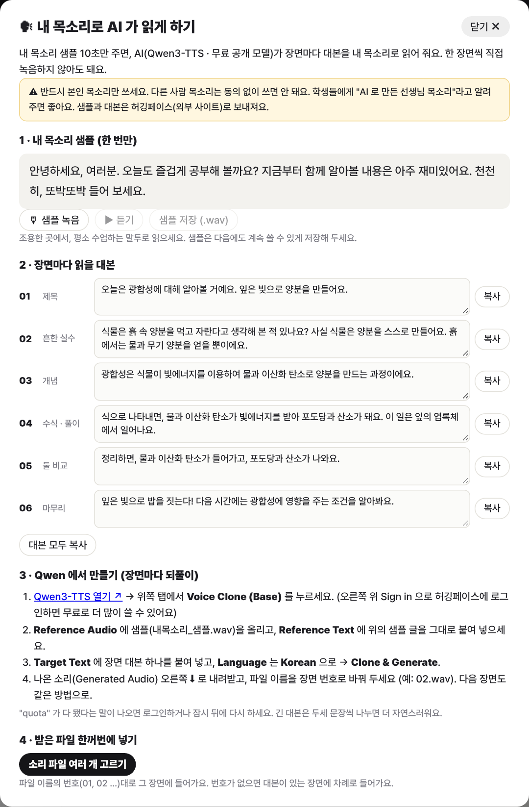

3. **샘플 녹음** → 회색 상자의 글을 평소 수업 말투로 읽기 → **샘플 저장 (.wav)**. (다음에도 계속 쓰니 잘 보관하세요)
4. **Qwen3-TTS 열기** → 위쪽 탭 **Voice Clone (Base)**
   - **Reference Audio**: 샘플 파일 올리기
   - **Reference Text**: 샘플 글 그대로 붙여 넣기
   - **Target Text**: 장면 대본 하나 붙여 넣기 (스튜디오의 **복사** 버튼)
   - **Language**: Korean → **Clone & Generate**
   - 나온 소리 오른쪽 ⬇ 로 받고, 이름을 장면 번호로 (예: `02.wav`)
5. 장면마다 4를 되풀이한 뒤, 스튜디오의 **소리 파일 여러 개 고르기**로 한꺼번에 넣으면 번호대로 들어갑니다.

- 허깅페이스에 **로그인**(오른쪽 위 Sign in · 무료 가입)하면 하루에 더 많이 만들 수 있어요. *quota* 가 다 됐다는 말이 나오면 로그인하거나 잠시 뒤에 하세요.
- ⚠️ **본인 목소리만** 쓰세요. 샘플과 대본은 허깅페이스(외부 사이트)로 보내집니다. 학생들에게 "AI 로 만든 선생님 목소리"라고 알려 주면 좋아요.
- 마음에 안 드는 장면은 그 장면만 다시 만들거나 🎙 로 직접 녹음해 덮어쓰면 됩니다.

---

## 7. 사진 넣기 (하고 싶을 때만)
1. **+ 장면 더하기 → 사진** 을 누르세요.
2. **📷 사진 넣기** 를 눌러 사진을 고르세요.
   - 복사한 사진은 그 칸을 한 번 누르고 **Ctrl + V** (맥은 ⌘ + V).
   - 사진 파일을 그 칸으로 끌어다 놓아도 됩니다.
3. 사진 위에서 **짚을 곳을 누르면** 번호가 생깁니다. 번호마다 **이름표**(예: 잎맥, 엽록체)를 적으세요.
4. **설명** 칸에 옆에 나올 글을 적으세요. `[[초록색]]` 처럼 묶으면 형광펜이 칠해집니다.

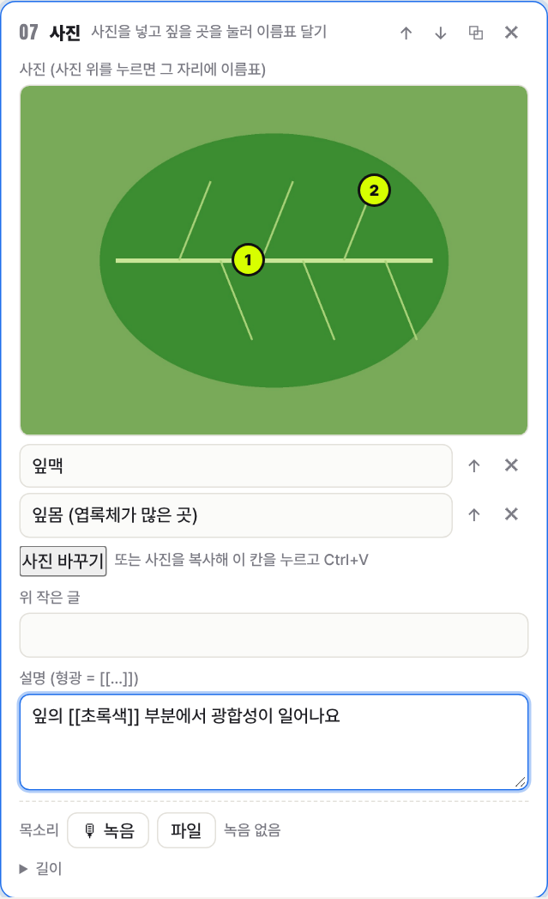

영상에서는 사진이 열리고 천천히 다가가며, 점이 번호 순서대로 짚을 때마다 이름표가 붙습니다. 큰 사진은 저절로 알맞게 줄여 담아요.

> ⚠️ 학생 얼굴은 **동의**를, 교과서 그림 · 인터넷 사진은 **저작권**을 먼저 확인하세요. 직접 찍은 사진이 가장 안전합니다.

---

## 8. 미리보기와 점검
- **▶ 재생** (또는 스페이스)으로 소리와 함께 처음부터 봅니다. 처음 누를 때 소리를 만드느라 1~2초 걸려요.
- 아래 장면 버튼(1 제목 · 2 흔한 실수 …)으로 원하는 장면에 바로 갈 수 있습니다.

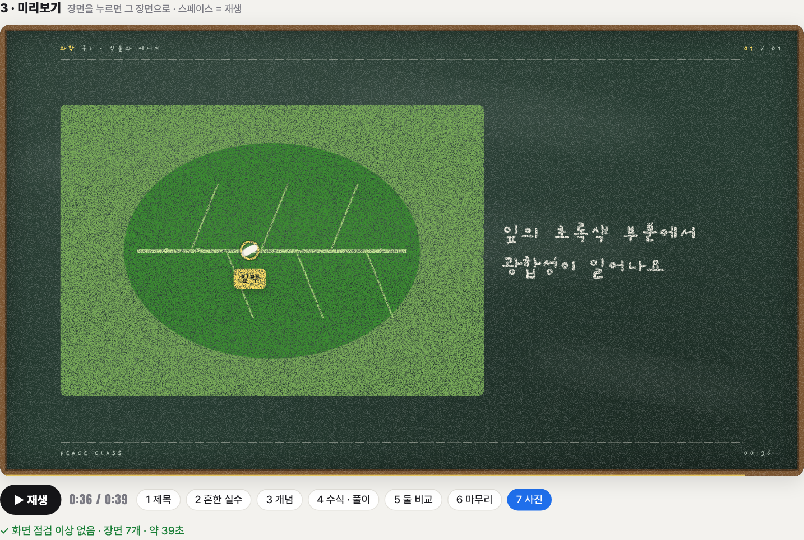

미리보기 아래에 **점검 결과**가 나옵니다.
- ✅ *화면 점검 이상 없음* 이면 그대로 저장하세요.
- 🟥 빨간 상자가 나오면 글이 화면을 넘쳤거나 겹친 것입니다. **글을 줄이거나 장면을 둘로 나누세요.**

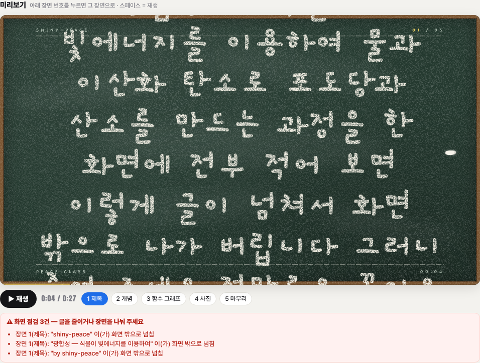

---

## 9. 저장하기
위쪽 버튼 두 개를 씁니다.

| 버튼 | 만들어지는 파일 | 쓰는 곳 |
|---|---|---|
| **수업용 파일 저장 ↓** | `광합성_수업용.html` | 수업 때 여는 파일 · 다른 선생님께 보내는 파일 |
| **시나리오 저장** | `광합성_시나리오.json` | 나중에 이어서 고칠 때 · Claude 에게 mp4 를 부탁할 때 |

- 크롬 · 엣지 · 웨일에서는 *"다른 이름으로 저장"* 창이 뜹니다. 저장할 곳(예: 바탕화면)을 고르고 **저장**.
- 이어서 고치려면: 스튜디오를 열고 **시나리오 열기** → 저장해 둔 `.json` 을 고르세요.
- 고치던 내용은 **같은 컴퓨터 · 같은 브라우저**에 저절로 보관됩니다. 다시 열면 *「이어서 하기」* 가 뜹니다. 다른 컴퓨터로 옮길 때는 시나리오 파일을 챙기세요.

---

## 10. 수업 시간에 틀기
저장한 `○○_수업용.html` 을 교실 컴퓨터에서 더블클릭하세요(크롬 · 엣지 · 웨일). 인터넷이 없어도 됩니다.

| 키 | 하는 일 |
|---|---|
| 클릭 · 스페이스 | 재생 / 멈춤 |
| → / ← | 다음 장면 / 앞 장면 (설명하다가 넘기기 좋아요) |
| F | 전체 화면 |
| R | 처음부터 |

다른 선생님께는 이 파일 **하나만** 보내면 됩니다(메일 · 메신저 · USB · 클래스룸 첨부). 받은 분도 **내려받아서** 브라우저로 열어야 해요.

---

## 11. mp4 영상 파일이 필요할 때
수업용 파일은 영상처럼 보이지만 **웹페이지**입니다. 유튜브 · 패들렛 · 클래스룸 동영상처럼 **mp4** 가 필요하면 둘 중 하나를 고르세요.

**방법 A · 윈도우에서 직접 녹화** (설치 없음)
1. 수업용 파일을 열고 **F** 로 전체 화면.
2. **Win + Alt + R** 로 녹화 시작 → 스페이스로 재생.
3. 끝나면 다시 **Win + Alt + R**. 영상은 **동영상 → 캡처** 폴더에 소리와 함께 저장됩니다.
   - 단축키가 안 되면: 설정 → 게임 → Xbox Game Bar 를 켜세요.

**방법 B · Claude 에게 부탁** (맥도 OK)
*시나리오 저장* 으로 받은 `.json` 을 Claude 에게 주고 *"이 시나리오로 mp4 만들어줘"* 라고 하세요. 고른 스타일과 녹음이 그대로 들어간 1920×1080 영상을 만들어 줍니다. (영상을 굽는 프로그램이 있는 Claude 환경에서 됩니다. 일반 채팅에서 안 되면 방법 A 를 쓰세요.)

> 맥의 화면 기록(⌘ + Shift + 5)은 소리가 함께 녹화되지 않습니다.

---

## 12. Claude 와 함께 만들기 (더 빠르게)
원고만 주면 Claude 가 장면을 짜서 **글이 다 채워진 스튜디오 파일**을 만들어 줍니다. 선생님은 3번부터 하면 됩니다.

### 스킬 올리기 (처음 한 번)
1. **[peace-class.zip 받기](../download/peace-class.zip)** → 오른쪽 위 ⬇ 버튼. **압축은 풀지 마세요.**
2. Claude(claude.ai 또는 데스크톱 앱) → **설정 → 기능(Capabilities)** 에서 **코드 실행 및 파일 만들기**(새 화면에서는 *파일 만들기 및 편집*)를 켭니다.
3. 왼쪽 **사용자 지정(Customize) → 스킬(Skills)** → **+** → **스킬 만들기** → **스킬 올리기(Upload a skill)** → `peace-class.zip` 을 고릅니다.
4. 목록에 생긴 **peace-class** 의 스위치를 켭니다.

> 메뉴 이름은 Claude 앱 업데이트에 따라 조금 바뀔 수 있어요. 무료 요금제에서도 쓸 수 있고, 학교 · 기관 계정(Team · Enterprise)은 관리자가 스킬을 막아 두었을 수 있습니다.

### Claude 가 처음에 묻는 것 — 체크해서 고르세요
스킬을 부르면 Claude 가 먼저 **필요한 것(위 표)** 을 알려 주고, 두 번에 나눠 체크로 묻습니다. 요청에 이미 적은 것은 묻지 않아요.

**① 무엇을 · 어디에** — 교과 · 학년 · 화면(16:9 / 9:16) · 사진이 있나요

**② 어떻게 보이고 들리게** — 화면 비율에 맞는 견본을 보여 주고, 교과에 맞는 스타일에 **(추천)** 을 붙여 줍니다.


| 질문 | 고를 것 |
|---|---|
| 어두운 바탕 (여러 개 체크 가능) | 1 형광 · 3 칠판 · 7 청사진 · 11 예고편 |
| 밝은 바탕 (여러 개 체크 가능) | 2 신문 · 4 공책 · 5 팝 · 6 모눈 |
| 특별한 결 (여러 개 체크 가능) | 8 먹 · 9 종이 공작 · 10 픽셀 |
| 목소리 | **내 목소리 샘플을 주면 Claude 가 읽어 넣기(추천)** · 내가 장면마다 직접 녹음 · 녹음 파일 있음 · 목소리 없이 |

mp4 는 따로 묻지 않아요. 기본은 수업용 파일이고, 영상을 구울 수 있는 환경이면 "mp4 도 만들까요?" 하고 물어요.

### 이렇게 말하세요
```
수업 영상 만들어줘. 중1 과학 광합성, 수업 도입 40초, 16:9.
전할 것: 식물은 양분을 스스로 만든다.
원문 사실: 광합성은 식물이 빛에너지를 이용하여 물과 이산화 탄소로 양분을 만드는 과정이다. …
마무리: 잎은 빛으로 밥을 짓는다.
```
- **교과서 · 학습지 · 판서 사진**을 함께 올리고 *"이걸로 수업 영상 만들어줘"* 라고 해도 됩니다. Claude 가 읽은 내용을 먼저 보여 주고 확인을 받습니다.
- Claude 가 **장면 표**를 보여 주면 확인하고 *"좋아요"* → **스튜디오 파일**을 받습니다 → 3번부터 하세요.
- 다 고친 뒤 **시나리오 저장** 파일을 다시 주면 Claude 가 이어서 손보거나 mp4 로 만들어 줍니다.

---

## 💬 Claude 에게 맡기기 (PC · 휴대폰 모두)
목소리 복제와 영상 굽기는 내 기기가 아니라 **Claude 의 클라우드 작업 공간**에서 돌아가요. 그래서 **PC 에서도, 휴대폰에서도 똑같이** 돼요. 내 기기는 파일을 보내고 결과를 받기만 해요.

1. **처음 한 번**: Claude 에 [peace-class.zip](../download/peace-class.zip) 스킬을 올리고 켜요([12번](#스킬-올리기-처음-한-번)). PC 에서 해 두면 편해요.
2. **목소리 샘플 녹음** — 10초쯤, 조용한 곳에서 문장 하나를 또박또박 읽어요. 예) "안녕하세요, 여러분. 오늘도 즐겁게 공부해 볼까요? 지금부터 함께 알아볼 내용은 아주 재미있어요."
   | 어디서 | 이렇게 |
   |---|---|
   | **PC** | 스튜디오 위쪽 **🗣 내 목소리 AI → 🎙 샘플 녹음 → 샘플 저장(.wav)** · 또는 윈도우 **녹음기** 앱 · 맥 **음성 메모** 앱 |
   | **휴대폰** | **음성 메모(녹음)** 앱 — m4a 그대로 보내도 돼요 |

   **마지막 "…요" "…다" 까지 다 말하고 1초 쉰 다음 멈추세요** — 끝 글자가 씹힌 샘플로 만들면 AI 목소리도 "…했습닏" 처럼 끝이 잘려요.
3. **보내기**: 새 대화에서 샘플 파일을 첨부하고, **읽은 문장을 그대로** 적고, 주제나 원고(또는 교과서 사진)를 보내요.
   ```
   수업 영상 만들어줘. 중1 과학 광합성, 수업 도입, 16:9.
   목소리는 이 샘플로 해 줘. 샘플에서 읽은 문장: 안녕하세요, 여러분. …
   ```
4. **고르기**: Claude 가 교과 · 화면을 묻고, 어울리는 스타일을 **(추천)** 과 함께 보여 줘요. 체크로 고르면 돼요.
5. **장면 표 확인**: 장면마다 화면 글과 **읽을 대사**를 보여 줘요. 사실은 교과서와 대조해 "좋아요" 또는 고칠 곳을 말해요.
6. **받기**: Claude 가 내 목소리로 대사를 만들어 넣고 **mp4** 를 보내 줘요. 스튜디오 파일도 함께 받으면 PC 에서 스타일 · 글을 더 고칠 수 있어요.

| 알아 둘 것 | |
|---|---|
| 걸리는 시간 | 1분 영상에 5~10분. 대화마다 처음에 목소리 모델을 까느라 몇 분 더 걸려요 |
| 목소리 품질 | 작업 공간은 GPU 가 없어 가벼운 모델(0.6B)을 써요. 아주 똑같지는 않을 수 있어요 |
| 끝 글자 씹힘 | 샘플 끝에 1초 쉬기 · 대사는 마침표로 끝내기. Claude 는 대사 끝에 마침표와 짧은 쉼을 붙여 만들어요. 그래도 잘린 장면은 그 장면만 다시 만들어 달라고 하세요 |
| 안전 | **본인 목소리만** 쓰세요. 샘플은 그 대화의 작업 공간 안에서만 쓰여요. 학생들에게 "AI 로 만든 선생님 목소리"라고 알려 주면 좋아요 |

## 🆘 이럴 땐
| 증상 | 해결 |
|---|---|
| 열었더니 아무것도 안 보이거나 코드만 보여요 | GitHub · 카카오톡 · 메일 · Claude 앱 **미리보기 안**에서 연 것입니다. **내려받은 뒤** 크롬 · 엣지 · 웨일로 여세요 |
| 더블클릭하면 메모장 · 다른 프로그램이 열려요 | 오른쪽 클릭 → 연결 프로그램 → 크롬 · 엣지 · 웨일 |
| 🎙 녹음을 눌러도 안 돼요 | 주소창 왼쪽 자물쇠(또는 ⓘ) → 마이크 → **허용** → 새로 고침. 윈도우 설정 → 개인 정보 → 마이크에서 브라우저가 허용됐는지도 보세요. 안 되면 휴대폰으로 녹음해 **파일**로 넣으세요 |
| 소리가 안 나요 | 컴퓨터 소리 · 브라우저 탭 음소거를 확인하세요. 처음 재생은 소리를 만드느라 1~2초 걸립니다 |
| 저장한 파일 이름이 `download` 예요 | 사파리 · 파이어폭스입니다. 크롬 · 엣지 · 웨일을 쓰거나 이름 끝에 `.html` 을 붙이세요 |
| 고치던 게 사라졌어요 | 같은 컴퓨터 · 같은 브라우저로 열면 *이어서 하기* 가 뜹니다. 시크릿 창에서는 보관되지 않아요 |
| 빨간 점검 상자가 떠요 | 글이 화면을 넘쳤어요. 글을 줄이거나 장면을 둘로 나누세요 |
| 화면의 한글이 이상한 글꼴로 나와요 | 거의 없는 일이지만, 스튜디오 파일을 새로 받아 보세요 |
| 휴대폰으로 만들고 싶어요 | **Claude 에게 맡기는 길**은 PC 와 똑같이 휴대폰에서도 돼요 → [💬 Claude 에게 맡기기](#-claude-에게-맡기기--pc--휴대폰-모두). 스튜디오는 화면이 넓어야 해서 PC 를 권해요. 수업용 파일 · mp4 는 휴대폰에서도 재생돼요 |

궁금한 점 · 고칠 점은 저장소의 **Issues** 에 남겨 주세요.
